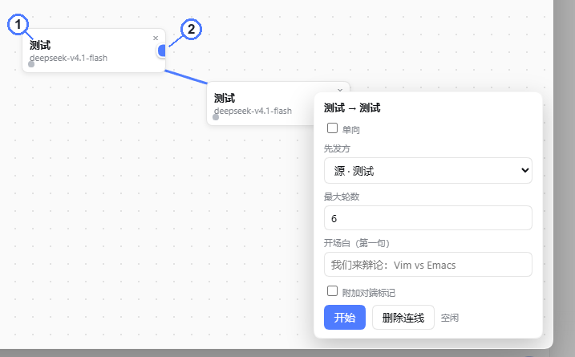
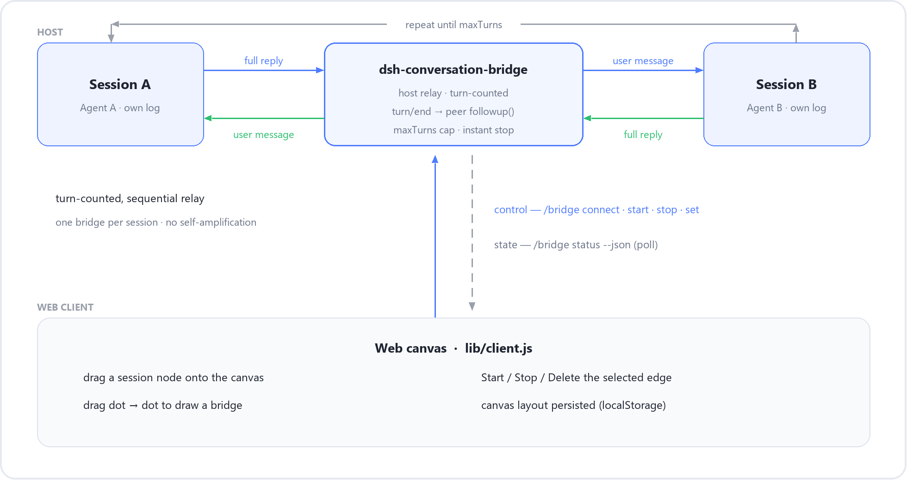
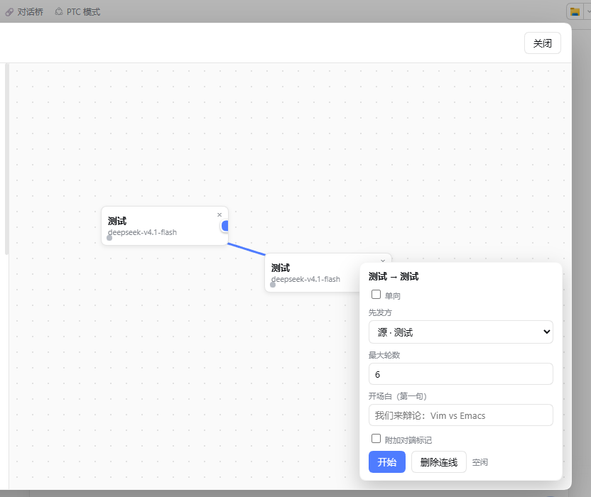
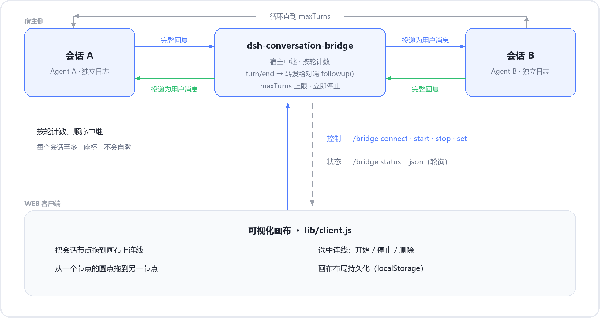

# dsh-conversation-bridge

[](LICENSE)
[](#requirements)
[](#requirements)
[](#under-the-hood)

**[English](#english) · [简体中文](#简体中文)**

Turn **two live DeepSeek Harness sessions** into an **auto-conversation**. Open the bridge canvas, drag a line from one session to another, press **Start** — session A's full reply is delivered to session B as a user message, B answers, the answer is delivered back to A, and so on until the turn cap or **Stop**.

The same host relay backs a `/bridge` slash command, so the canvas and the CLI behave identically.



> **①** a session node — any open session can be placed on the canvas  **②** its output dot — drag from here onto another node to create a bridge  **③** the selected bridge — one-way/two-way, first speaker, max turns, opener, peer prefix, then **Start**.

---

## English

### Features

| Feature | What it gives you |
| --- | --- |
| **Visual drag-to-connect canvas** | Sessions are listed on the left (grouped by workspace, collapsible, newest first) and dropped onto a pannable canvas on the right. Drag dot → node to draw a directed edge. Positions and edges live in `localStorage`, so the layout survives a refresh. |
| **Two-way or one-way** | `both` relays A ↔ B; `oneway` relays only the source side A → B. |
| **Opening line + turn cap** | Choose the **first speaker**, an optional **seed** ("we are debating Vim vs Emacs") and the **max turns**. |
| **Optional peer prefix** | Prefix each relayed message with `[对端] ` so the receiving model can tell bridge input apart from a human's. |
| **Command fallback** | Every canvas button is a `/bridge …` command, so the composer is a guaranteed fallback for headless profiles, scripts and debugging. |
| **Anti-loop by construction** | One bridge per session, turn-counted sequential relay, `maxTurns` enforced *before* forwarding, instant stop. |
| **One package, both halves** | `lib/index.js` is mounted on the host, `lib/client.js` in the Web client — no second package, no custom remote namespace. |
| **Zero runtime dependencies** | Plain ESM, no imports at all in the host half, state kept in memory. |

### How it works



1. A bridged session finishes a model turn → the host sees its `turn/end` session event.
2. The relay takes that session's **last assistant message** and delivers it to the peer with `Agent.followup(...)` — the agent loop's own next-turn primitive, so the peer wakes up and replies exactly once.
3. The peer's reply completes its own `turn/end`, which is forwarded back the same way.
4. The loop stops at `maxTurns`, on **Stop**, or when the peer closes. Nothing is ever written to either session log.

**Control and state channels**

- **Client → host (control)** rides the stock **Commands RPC** the composer already uses: the canvas calls `ctx.remote.commands.execute(sessionId, '/bridge …', [])`.
- **Host → client (state)** rides a poll of `/bridge status --json` — one shot when the panel opens, then every 2.5 s *only while the panel is open and a bridge is running*.

Bridge state is deliberately **in memory only**. The public `session.append` cannot mark a custom event type as ignorable, and a custom `bridge/*` event in the log makes the harness refuse to load that session on restart — so the relay never writes one.

### Requirements

- **DeepSeek Harness (dsh) `0.2.1-rc.2`** (the `0.2.x` line) — the dsh packages ship compiled JS without type declarations. The package declares `engines.dsh: ">=0.2.1-rc.2 <0.3.0"` purely as documentation of the window it was built against; dsh treats that range as declarative and does not enforce it. The floor matters because the client half must inject the package that provides the slot service, and that package was renamed from `dsh-client-ui-slots` to `dsh-client-ui-renderer` in `0.2.1-rc.2`.
- The **Web** client: the canvas is a Web UI plugin injected into the `conversation.session.header.actions` slot.
- **Two open sessions** (each with a live agent) before you press Start; drawing and connecting work regardless.
- React 18, provided by the host UI, is the only peer dependency the client half needs.

### Install

This is a **local dsh plugin**, not an npm package: it is installed next to a profile and mounted through that profile's `cordis.patch.yml`.

```powershell
# 0) get the code
git clone https://github.com/<your-account>/dsh-conversation-bridge.git
```

```powershell
# 1) copy the live profile to a scratch profile (never edit the live one)
Copy-Item -Recurse "$env:USERPROFILE\.dsh\profiles\desktop" "$env:USERPROFILE\.dsh\profiles\bridge-test"

# 2) make the package resolvable from that profile: add it to the profile's package.json
#    ("file:" paths are absolute and use forward slashes)
#      "@local/dsh-conversation-bridge": "file:C:/path/to/dsh-conversation-bridge"
#    then install with the bundled runtime:
& "$env:USERPROFILE\.dsh\dsh-runtimes\dsh-primary-runtime\dependencies\node\bin\node.exe" `
  "$env:USERPROFILE\.dsh\dsh-runtimes\dsh-primary-runtime\dependencies\pnpm\bin\pnpm.mjs" `
  --dir "$env:USERPROFILE\.dsh\profiles\bridge-test" install

# 3) append the loader rows from cordis.patch.yml to the scratch profile's cordis.patch.yml

# 4) launch the GUI against the scratch profile and open the printed URL
npx @deepseek-ai/dsh web --profile bridge-test
```

The rows to append (already in this package's [`cordis.patch.yml`](cordis.patch.yml)):

```yaml
- insert:
    - id: dsh-conversation-bridge
      name: "@local/dsh-conversation-bridge"
      config:
        defaultMaxTurns: 6
        prefixPeerLabel: false
```

`insert` places the row *after* the base bundle layers, so the relay sees the already-mounted `agents`, `sessions` and `commands` services. Registration is a Cordis effect, so unmounting the plugin rolls back the command and every event listener automatically.

Dry run without launching the GUI: `npx @deepseek-ai/dsh --profile bridge-test --dump-config` prints the resolved loader graph.

> Publishing note: the package is `"private": true` and named `@local/dsh-conversation-bridge`. Rename it (and drop `private`) if you ever want to publish it to a registry.

### Usage — the canvas

1. Open **two** sessions in the Web UI.
2. In either session's conversation header click **🔗 对话桥 / Bridge**.
3. Drag a session from the left list onto the right-hand canvas.
4. **Drag** from a node's blue dot to another node → a bridge edge is created.
5. Click the edge: pick the **first speaker**, **max turns**, an optional **opener**, toggle **one-way** / **peer prefix**, then **Start**.
6. While running, the edge animates and shows turns done and the A → B / B → A direction. **Stop** halts immediately; **Delete** removes the bridge.



A page refresh or reconnect is harmless: the canvas is redrawn from `localStorage` and reconciled with the host through `/bridge status --json`.

### Usage — the `/bridge` command

| Command | What it does |
| --- | --- |
| `/bridge connect <A> <B> [--oneway]` | Create an idle bridge between two session ids. |
| `/bridge start [<ref>] [--from <id>] [--max-turns N] [--seed "…"] [--prefix on\|off]` | Start (or restart) relaying; `--from` picks the first speaker, `--seed` sends the opening message. |
| `/bridge set [<ref>] [--max-turns N] [--prefix on\|off]` | Update an existing bridge **without sending any message**. |
| `/bridge stop [<ref>]` | Stop relaying, keep the edge. |
| `/bridge disconnect [<ref>]` | Remove the bridge entirely. |
| `/bridge status [--json]` | List bridges; `--json` is what the canvas polls. |

`<ref>` is a `pairId` ("`<A>::<B>`") or any member session id. When it is omitted the command operates on the bridge that contains the **current** session.

### Anti-loop guarantees

Self-amplification is prevented **by construction**, not by heuristics:

- **One bridge per session** — `connect` rejects an already-bridged session, so a relayed message can never fan out into a second bridge.
- **Turn-counted, sequential relay** — exactly one message is forwarded per completed turn, and a per-pair `busy` guard blocks re-entrant forwarding within the same tick.
- **`maxTurns` is checked before forwarding** — the `(maxTurns+1)`-th message is never sent.
- **Stop/unmount unlistens immediately** — the `session/event` listener is removed on stop, at the cap, and on plugin unload (Cordis effect). No listener outlives a running bridge.
- Relayed input is a plain `{ kind: 'user' }` message with a freshly generated id, so it passes the session's strict message validation and only genuine completed model turns trigger a relay.

### Limitations

- **Both sessions must be open** (live agents) before `start`; starting against a closed session errors.
- **A host restart does not resume an in-flight bridge** — bridge state is in memory by design. The canvas recovers, the relay does not: press Start again.
- **Direction indicator** reflects the last forwarded message (`lastFrom`); before the first relay it shows the nominal A → B.
- **One-way mode** forwards only the source side and never returns the peer's reply.
- The optional **ring relay** (A → B → C → A) and per-round delays are **not** implemented — the engine is strictly pair-oriented.
- Developer preview: the plugin talks to `ctx` services whose compiled sources were read and are listed below; a dsh upgrade may move them.

### Project layout

```
dsh-conversation-bridge/
├─ package.json          # dsh manifest: bundle.patch + client.{platform,inject}
├─ cordis.patch.yml      # mount layer (loader rows appended to a profile)
├─ lib/
│  ├─ index.js           # HOST half   — prebuilt ESM, the mounted artifact
│  └─ client.js          # CLIENT half — prebuilt window.__ModuleLoader__.load form
├─ src/
│  ├─ index.ts           # authoritative TypeScript source for lib/index.js
│  └─ client.tsx         # authoritative TSX source      for lib/client.js
├─ locale/{en,zh}.json   # UI dictionaries (also inlined in the client bundle)
└─ docs/images/          # screenshots and diagrams used by this README
```

### Under the hood

**`src/*` is the source of truth; `lib/*` is what ships.** The browser build toolchain is not available in this environment, so `lib/client.js` is hand-authored in the `window.__ModuleLoader__.load({ id, factory })` form the Web client loader understands; `src/client.tsx` documents the same component tree in idiomatic React/TSX for review and future rebuilds.

**Why a zero-import functional plugin?** The package is installed *outside* the profile tree. `@deepseek-ai/cordis` is bundled inside the app's `app.asar` and is **not resolvable** from the profile's module tree; the dsh loader imports plugin host halves through Node's chained ESM loader and does not register a resolve hook for nested bare imports. A top-level `import { Service } from '@deepseek-ai/cordis'` therefore fails with `ERR_MODULE_NOT_FOUND`, the host row throws on load, and `/bridge`, the canvas and the client bundle silently disappear. Shipping `export default apply` (with `apply.inject`, no imports) avoids that entirely: every cordis primitive (`ctx.effect`, `ctx.inject`, `ctx.on`, `ctx.root`) is reached through the passed `ctx`. Do **not** vendor a copy of cordis into the profile — that creates a second module instance and breaks the service registry.

| Purpose | API used (read from the shipped compiled packages) |
| --- | --- |
| Plugin mount | functional `export default apply` + `apply.inject = ['agents','sessions']` |
| Live agent | `ctx.agents.get(id)` → `Agent` with `.status`, `.session.id`, `.followup({ id, role:'user', content, source })` |
| Reply-complete signal | `ctx.on('session/event', …)` where `event.type === 'turn/end'` |
| Session read | `ctx.sessions.get(id)` → `session.deriveMessages()` |
| Command | `ctx.inject(['commands'], c => c.commands.register({ name, description, input: { hint }, handler }))` |
| Lifecycle | `ctx.effect(fn, label)` — auto-rollback on unload |
| Client shipped form | `window.__ModuleLoader__.load({ id, factory })` exposing `exports.apply` / `exports.inject` |
| Client slots | `ctx.slots.inject('conversation.session.header.actions', () => ctx.slots.register({ … }, Component))` |
| Client control | `ctx.remote.commands.execute(sessionId, line, [])` |

**Why not Agent Teams?** `dsh-experimental-agent-team` models one lead plus spawned teammates inside a shared workspace — subagents of a single session tree, not two independent top-level sessions. This bridge links two **peer** sessions that each own their own agent and log, so the correct primitive is the agent loop's own `followup(input)`. It does reuse the Team patterns that fit: a log-free state journal and a projection-like snapshot for the UI.

### License

[MIT](LICENSE)

---

## 简体中文

把**两个正在运行的 DeepSeek Harness 会话**接成一场**自动对话**：打开对话桥画布，从一个会话拉一条线到另一个会话，点「开始」——A 的完整回复会作为用户消息投递给 B，B 回复后又被投递回 A，如此往复，直到达到轮数上限或点「停止」。

画布上的每个按钮背后都是一条 `/bridge` 命令，宿主端用的是同一个中继引擎，所以画布和命令行行为完全一致。


> **①** 会话节点：任何已打开的会话都能放到画布上  **②** 输出圆点：从这里拖到另一个节点即建立对话桥  **③** 选中的连线：单向/双向、先发方、最大轮数、开场白、附加对端标记，然后是「开始」。

### 功能特性

| 特性 | 说明 |
| --- | --- |
| **可视化拖拽连线** | 左侧按工作区分组列出所有会话（可折叠、按最近更新排序），可拖到右侧可平移的画布上；从一个节点的圆点拖到另一个节点即画出有向连线。节点位置与连线保存在 `localStorage`，刷新页面不丢布局。 |
| **双向 / 单向** | `both` 为 A ↔ B 互相转发；`oneway` 只转发源端 A → B。 |
| **开场白 + 轮数上限** | 可指定**先发方**、可选的**开场白**（例如「我们来辩论：Vim vs Emacs」）以及**最大轮数**。 |
| **可选对端标记** | 转发的消息可加上 `[对端] ` 前缀，让接收方模型能区分「桥来的输入」和真人输入。 |
| **命令兜底** | 画布上的每个操作都对应一条 `/bridge …` 命令，无头环境、脚本和排障都能用。 |
| **结构上防自激** | 每个会话至多一座桥、按轮计数顺序中继、转发**前**检查 `maxTurns`、随时立即停止。 |
| **一个包两半** | `lib/index.js` 挂在宿主端，`lib/client.js` 跑在 Web 客户端，不需要第二个包，也不需要自定义 remote 命名空间。 |
| **零运行时依赖** | 纯 ESM，宿主端一个 `import` 都没有，状态只放在内存里。 |

### 工作原理



1. 已连线的会话完成一次模型回合 → 宿主端收到该会话的 `turn/end` 事件。
2. 中继取该会话**最后一条 assistant 消息**，用 `Agent.followup(...)` 投递给对端——这是 agent 循环自己的「下一回合输入」原语，会唤醒对端并让它恰好回复一次。
3. 对端的回复完成它自己的 `turn/end`，再按同样方式转发回去。
4. 达到 `maxTurns`、点「停止」或对端关闭时循环结束。整个过程不会往任何会话日志里写东西。

**控制与状态两条通道**

- **客户端 → 宿主（控制）**走的是输入框本来就在用的 **Commands RPC**：画布调用 `ctx.remote.commands.execute(sessionId, '/bridge …', [])`。
- **宿主 → 客户端（状态）**走 `/bridge status --json` 轮询：打开面板时对账一次，之后仅在「面板打开且确实有桥在跑」时每 2.5 秒一次。

桥接状态刻意**只存在内存中**：公开的 `session.append` 无法把自定义事件类型标记为可忽略，而日志里一旦出现 `bridge/*` 事件，重启后整个会话都会加载失败——所以中继绝不写这类事件。

### 环境要求

- **DeepSeek Harness (dsh) `0.2.1-rc.2`**（`0.2.x` 线）——dsh 各包只发布编译后的 JS，不带类型声明。包里用 `engines.dsh: ">=0.2.1-rc.2 <0.3.0"` 标注构建时的版本窗口，但 dsh 只把它当声明性元数据，并不会据此拦截。这条下限真正的意义是：客户端半边必须注入提供插槽服务的包，而该包在 `0.2.1-rc.2` 里从 `dsh-client-ui-slots` 改名成了 `dsh-client-ui-renderer`。
- **Web 客户端**：画布是注入到 `conversation.session.header.actions` 插槽的 Web UI 插件。
- 点「开始」前需要**两个已打开的会话**（各自有活着的 agent）；拖拽和连线本身不受影响。
- 客户端半边唯一的 peer dependency 是宿主 UI 自带提供的 React 18。

### 安装

这是一个**本地 dsh 插件**，不是 npm 包：把它装到某个 profile 旁边，再通过该 profile 的 `cordis.patch.yml` 挂载。

```powershell
# 0) 取代码
git clone https://github.com/<your-account>/dsh-conversation-bridge.git
```

```powershell
# 1) 把正在用的 profile 复制成一份实验 profile（不要直接改正在服务 GUI 的那个）
Copy-Item -Recurse "$env:USERPROFILE\.dsh\profiles\desktop" "$env:USERPROFILE\.dsh\profiles\bridge-test"

# 2) 让实验 profile 能解析到这个包：在它的 package.json 里加依赖
#    （file: 路径要用绝对路径 + 正斜杠）
#      "@local/dsh-conversation-bridge": "file:C:/path/to/dsh-conversation-bridge"
#    然后用 dsh 自带的运行时安装：
& "$env:USERPROFILE\.dsh\dsh-runtimes\dsh-primary-runtime\dependencies\node\bin\node.exe" `
  "$env:USERPROFILE\.dsh\dsh-runtimes\dsh-primary-runtime\dependencies\pnpm\bin\pnpm.mjs" `
  --dir "$env:USERPROFILE\.dsh\profiles\bridge-test" install

# 3) 把 cordis.patch.yml 里的挂载行追加到实验 profile 的 cordis.patch.yml

# 4) 用实验 profile 启动 GUI，打开它打印出来的地址
npx @deepseek-ai/dsh web --profile bridge-test
```

要追加的内容（就在本包的 [`cordis.patch.yml`](cordis.patch.yml) 里）：

```yaml
- insert:
    - id: dsh-conversation-bridge
      name: "@local/dsh-conversation-bridge"
      config:
        defaultMaxTurns: 6
        prefixPeerLabel: false
```

`insert` 会把这一行加在基础 bundle 层**之后**，因此中继能看到已经挂载好的 `agents`、`sessions`、`commands` 服务。注册本身是 Cordis effect，卸载插件时会自动回滚命令和所有事件监听。

不启动 GUI 也能干跑：`npx @deepseek-ai/dsh --profile bridge-test --dump-config` 会打印解析后的 loader 图。

> 发布提示：包里是 `"private": true`，名字是 `@local/dsh-conversation-bridge`。如果要发到 registry，记得改名并去掉 `private`。

### 使用 — 画布

1. 在 Web UI 里打开**两个**会话。
2. 在任一会话的对话头部点 **🔗 对话桥**。
3. 把左侧列表里的会话拖到右侧画布上。
4. 从一个节点的蓝色圆点**拖**到另一个节点 → 生成一条连线。
5. 点这条连线：选择**先发方**、**最大轮数**、可选的**开场白**，按需勾选**单向** / **附加对端标记**，然后点**开始**。
6. 运行中连线会流动显示，并标出已完成轮数和 A → B / B → A 的方向；点**停止**立即停下，点**删除连线**移除这座桥。


刷新页面或重连不会有问题：画布会从 `localStorage` 重画，并通过 `/bridge status --json` 与宿主对账。

### 使用 — `/bridge` 命令

| 命令 | 作用 |
| --- | --- |
| `/bridge connect <A> <B> [--oneway]` | 在两个会话 id 之间建立一座空闲的桥。 |
| `/bridge start [<ref>] [--from <id>] [--max-turns N] [--seed "…"] [--prefix on\|off]` | 开始（或重开）中继；`--from` 指定先发方，`--seed` 投递开场白。 |
| `/bridge set [<ref>] [--max-turns N] [--prefix on\|off]` | 更新已有桥的参数，**不发送任何消息**。 |
| `/bridge stop [<ref>]` | 停止中继，保留连线。 |
| `/bridge disconnect [<ref>]` | 彻底删除这座桥。 |
| `/bridge status [--json]` | 列出所有桥；画布轮询的就是 `--json`。 |

`<ref>` 可以是 `pairId`（"`<A>::<B>`"）或任意一端会话 id；省略时作用于**当前会话**所在的那座桥。

### 防自激保证

自激放大是**从结构上**杜绝的，而不是靠启发式判断：

- **每个会话至多一座桥**——`connect` 会拒绝已经连线的会话，转发出去的消息不可能再扇出到第二座桥。
- **按轮计数、顺序中继**——每完成一个回合只转发一条消息，每个 pair 还有 `busy` 守卫阻止同一 tick 内重入转发。
- **转发前检查 `maxTurns`**——第 `maxTurns+1` 条消息永远不会发出去。
- **停止/卸载立即解除监听**——`session/event` 监听器在停止、达到上限、插件卸载（Cordis effect）时都会移除，不会有监听器活过一座正在跑的桥。
- 转发内容是带新 id 的普通 `{ kind: 'user' }` 消息，能通过会话严格的消息校验；只有真正完成的模型回合才会触发转发。

### 已知限制

- 点 `start` 前**两个会话都必须是打开的**（有活着的 agent），否则会报错。
- **宿主重启不会自动续跑进行中的桥**——桥状态按设计只存在内存里。画布能恢复，中继不会，再点一次「开始」即可。
- **方向指示**反映最后一条被转发的消息（`lastFrom`）；首次转发前显示名义上的 A → B。
- **单向模式**只转发源端，不会把对端回复送回。
- 可选的**环形中继**（A → B → C → A）和每轮延迟**没有实现**——引擎严格是成对的。
- 开发预览阶段：插件依赖的 `ctx` 服务都是从已安装的编译产物里读出来的（见下表），dsh 升级可能改变它们。

### 目录结构

```
dsh-conversation-bridge/
├─ package.json          # dsh manifest：bundle.patch + client.{platform,inject}
├─ cordis.patch.yml      # 挂载层（追加到 profile 的 loader 行）
├─ lib/
│  ├─ index.js           # 宿主端   — 预构建 ESM，真正被挂载的产物
│  └─ client.js          # 客户端   — 预构建 window.__ModuleLoader__.load 形式
├─ src/
│  ├─ index.ts           # lib/index.js 的权威 TypeScript 源码
│  └─ client.tsx         # lib/client.js 的权威 TSX 源码
├─ locale/{en,zh}.json   # UI 文案（同时内联在客户端产物里）
└─ docs/images/          # 本 README 用到的截图和示意图
```

### 实现细节

**`src/*` 是源码真相，`lib/*` 是随包发布的产物。** 当前环境没有浏览器端构建工具链，所以 `lib/client.js` 是按 Web 客户端 loader 认识的 `window.__ModuleLoader__.load({ id, factory })` 形式手写的；`src/client.tsx` 用标准 React/TSX 记录同一棵组件树，便于审阅和日后重新构建。

**为什么是「零 import 的函数式插件」？** 这个包装在 profile 目录树**之外**。`@deepseek-ai/cordis` 被打包在应用的 `app.asar` 里，从 profile 的模块树里**解析不到**；dsh loader 通过 Node 的链式 ESM loader 导入插件宿主半边，并不会为嵌套的裸导入注册解析钩子。因此顶层写 `import { Service } from '@deepseek-ai/cordis'` 会以 `ERR_MODULE_NOT_FOUND` 失败，宿主行加载即抛错，`/bridge`、画布和客户端产物会一起静默消失。改成 `export default apply`（带 `apply.inject`、不含任何 import）就绕开了这个问题：所有 cordis 原语（`ctx.effect`、`ctx.inject`、`ctx.on`、`ctx.root`）都从传入的 `ctx` 上取。另外**不要**把 cordis 复制一份进 profile——那会产生第二个模块实例，反而破坏服务注册。

| 用途 | 使用的 API（均读自已安装的编译产物） |
| --- | --- |
| 插件挂载 | 函数式 `export default apply` + `apply.inject = ['agents','sessions']` |
| 活着的 agent | `ctx.agents.get(id)` → `Agent`，有 `.status`、`.session.id`、`.followup({ id, role:'user', content, source })` |
| 回合完成信号 | `ctx.on('session/event', …)`，其中 `event.type === 'turn/end'` |
| 读会话 | `ctx.sessions.get(id)` → `session.deriveMessages()` |
| 命令 | `ctx.inject(['commands'], c => c.commands.register({ name, description, input: { hint }, handler }))` |
| 生命周期 | `ctx.effect(fn, label)`——卸载时自动回滚 |
| 客户端发布形式 | `window.__ModuleLoader__.load({ id, factory })`，导出 `exports.apply` / `exports.inject` |
| 客户端插槽 | `ctx.slots.inject('conversation.session.header.actions', () => ctx.slots.register({ … }, Component))` |
| 客户端控制 | `ctx.remote.commands.execute(sessionId, line, [])` |

**为什么不用 Agent Teams？** `dsh-experimental-agent-team` 建模的是「一个 Lead + 在共享工作区里孵化的队友」——属于同一棵会话树的子 agent，而不是两个互相独立、各自拥有 agent 和日志的顶层会话。本桥连接的是两个**对等**会话，所以正确的原语是 agent 循环自己的 `followup(input)`；只复用 Team 中合适的那部分模式（不落日志的状态快照与前端同步）。

### 许可证

[MIT](LICENSE)
